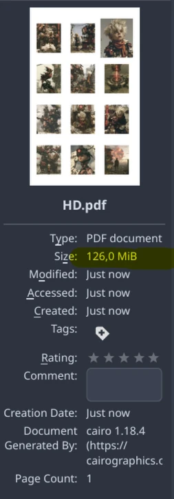
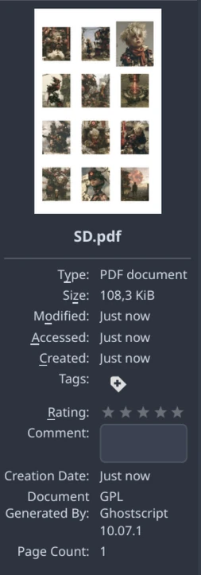
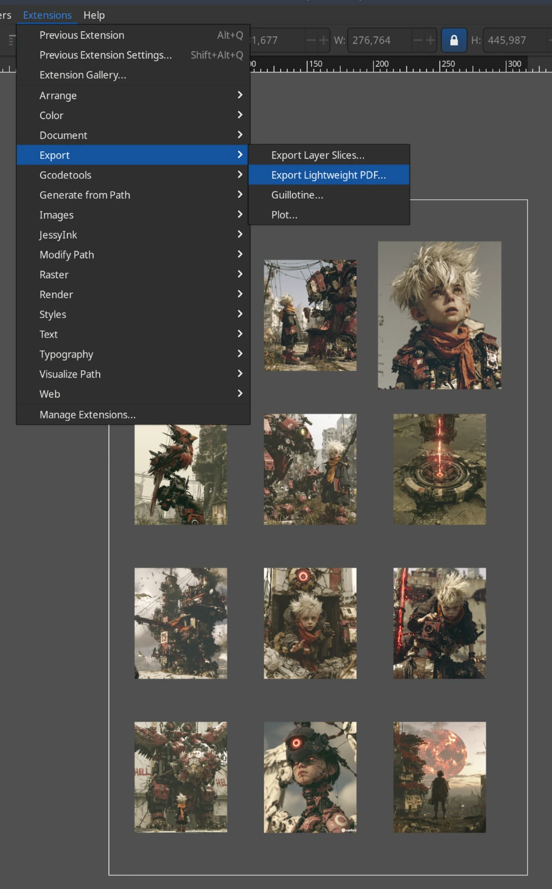
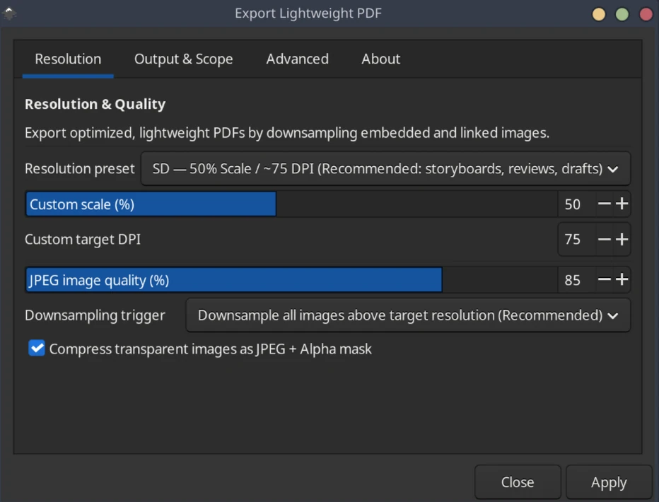
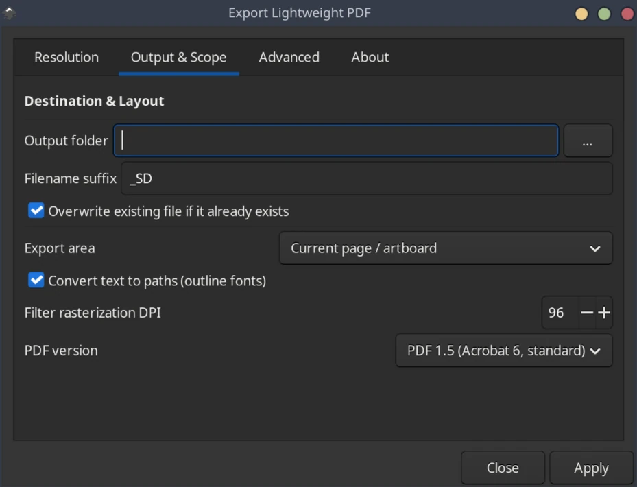
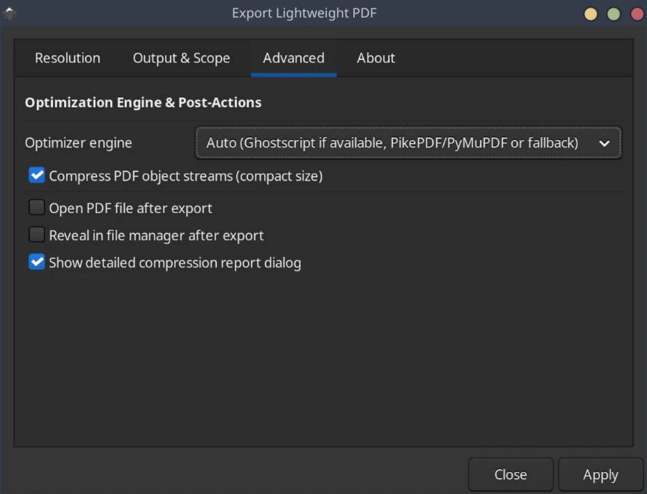
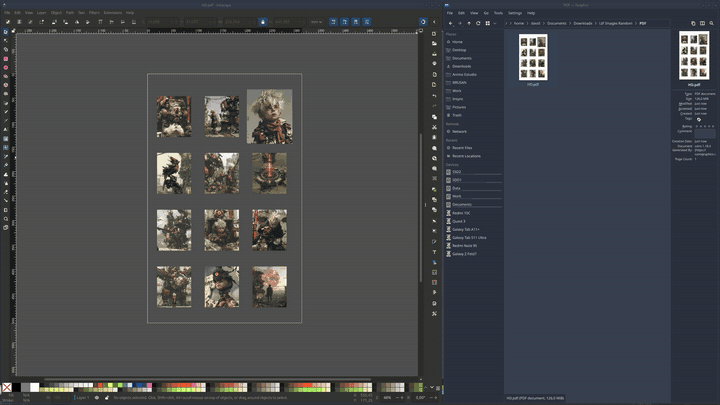

# Export Lightweight PDF

An Inkscape extension that exports a lightweight PDF with the embedded images downsampled to the resolution you choose.

When a document holds high-resolution photos, renders, or storyboard panels, Inkscape often writes a PDF of 50 to 100 MB or more, because Cairo embeds the raster images with little or no lossy compression. This extension exports the PDF and recompresses those images to your target resolution. Vector paths, text, fonts, and layout stay untouched. Typical savings reach 95%.





## Install

Inkscape 1.2 or newer. Developed and tested on 1.4.

It needs Ghostscript (`gs`):

- Arch Linux / Manjaro: `sudo pacman -S ghostscript`
- Ubuntu / Debian: `sudo apt install ghostscript`
- Fedora: `sudo dnf install ghostscript`
- macOS: `brew install ghostscript`
- Windows: the AGPL installer from [ghostscript.com](https://ghostscript.com/releases/)

```bash
mkdir -p ~/.config/inkscape/extensions
git clone https://github.com/davidbrum25/inkscape-export-lightweight-pdf.git \
  ~/.config/inkscape/extensions/export-lightweight-pdf
```

Restart Inkscape. The command is **Extensions → Export → Export Lightweight PDF**.

On Windows the extensions folder is `%APPDATA%\inkscape\extensions`.

## Use

1. Open your SVG document.
2. Open **Extensions → Export → Export Lightweight PDF**.
3. Pick a resolution preset and the JPEG quality. Leave the output folder empty to save in your home folder.
4. Apply. A report shows the size before and after, and the percentage saved.









A short screen recording of the whole flow:



The same recording as a smaller video file: [screen_sample.webm](media/screen_sample.webm).

## Options

### Resolution

| Option | What it does |
| --- | --- |
| Resolution preset | SD (50%, about 75 DPI), Screen (96 DPI), Draft (25%, about 50 DPI), HD (75%, about 150 DPI), Print (300 DPI), or a custom value. |
| Custom scale (%) | Percentage applied when the preset is custom scale. |
| Custom target DPI | DPI applied when the preset is custom DPI. |
| JPEG image quality (%) | Compression quality for photos and bitmaps. The default is 85. |
| Downsampling trigger | Downsample every image above the target resolution, or only those above 1.5 times it. |
| Compress transparent images as JPEG + Alpha mask | On by default. Splits transparent images into an RGB JPEG and an alpha mask (`/SMask`), so transparency stays clean and the file stays small. |

### Output and scope

| Option | What it does |
| --- | --- |
| Output folder | Where the PDF is saved. If empty, your home folder is used. |
| Filename suffix | Added before `.pdf`. The default is `_SD`. |
| Overwrite existing file | Replaces a file with the same name. Off, a counter (`_1`, `_2`) is added. |
| Export area | Current page, all pages (multi-page PDF), the whole drawing, or the selected objects. |
| Convert text to paths | Outlines all text, so no fonts need to be installed where the PDF is opened. |
| Filter rasterization DPI | DPI used when Inkscape rasterizes blur and filter effects. The default is 96. |
| PDF version | 1.4, 1.5 (default), 1.6, or 1.7. |

### Advanced

| Option | What it does |
| --- | --- |
| Optimizer engine | Auto (recommended), Ghostscript, or PikePDF if installed. |
| Compress PDF object streams | Flate-compresses cross-reference tables and streams. |
| Open PDF file after export | Opens the PDF in the system viewer. |
| Reveal in file manager after export | Opens the destination folder. |
| Show detailed compression report | Shows the size before and after, and the percentage saved. |

## License

[GPL-2.0-or-later](LICENSE). Same license family as Inkscape's own extensions.
